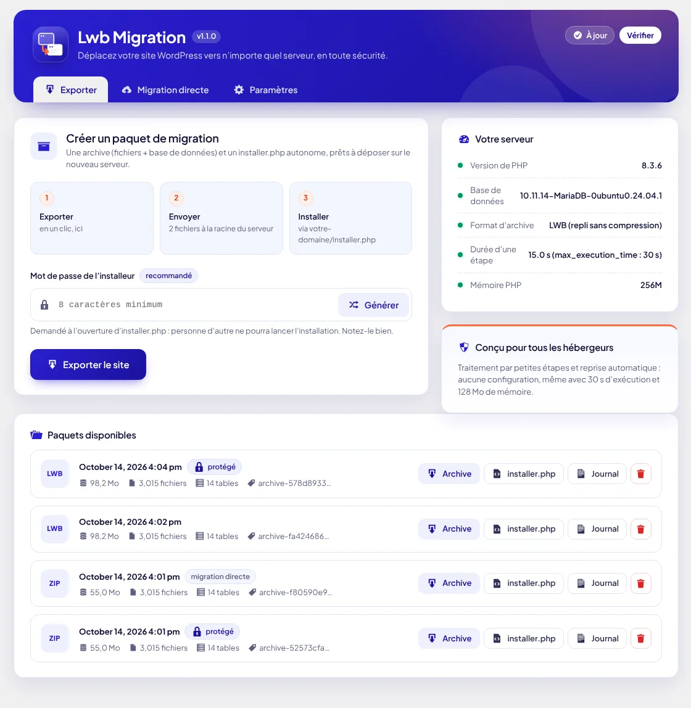

# Lwb Migration


Extension WordPress qui migre un site complet (fichiers + base de données) vers n'importe quel serveur, sans configuration, y compris sur les hébergements mutualisés les plus limités.

- **Export** : un clic produit `archive-<aléatoire>.zip` + `installer.php` autonome.
- **Import** : déposez les 2 fichiers à la racine du nouveau serveur (même vide), ouvrez `votre-domaine/installer.php`.
- **Migration directe** : transfert de serveur à serveur en HTTPS, par morceaux, avec une clé signée HMAC (24 h, usage unique).

Compatibilité : PHP 7.4 → 8.4, WordPress 5.8+, MySQL 5.6+ / MariaDB 10.1+. Aucune dépendance à `exec()`, `mysqldump`, `zip` CLI, SSH ou Composer. Fonctionne avec `max_execution_time = 30`, `memory_limit = 128M`, `upload_max_filesize = 2M`.

**Page officielle et téléchargement :** https://lewebmax.com/lwb-migration/ · [Dernière version (zip)](https://github.com/Jepht3/lwb-migration/releases/latest/download/lwb-migration.zip)



## Guide d'utilisation

### A. Migration classique (archive + installer.php)

1. **Sur le site à migrer** : *Lwb Migration → Exporter*. Cliquez sur « Générer » pour créer un mot de passe d'installeur (notez-le), puis **Exporter le site**. Si la connexion coupe, l'export reprend tout seul au dernier point de sauvegarde (bouton « Reprendre » sinon).
2. Téléchargez **l'archive** et **installer.php**.
3. **Sur le nouveau serveur** : créez la base de données dans le panneau de l'hébergeur (ou laissez l'installeur la créer si vos droits le permettent), puis envoyez les deux fichiers par FTP (mode binaire) à la racine du site.
4. Ouvrez `https://votre-domaine/installer.php` et saisissez le mot de passe.
5. **Étape 1 – Vérification** : tout doit être vert ou orange. **Étape 2 – Base de données** : hôte, nom, utilisateur, mot de passe, préfixe (modifiable). Cliquez sur **Tester la connexion**, puis **Lancer l'installation**. L'adresse et le dossier du nouveau site sont détectés automatiquement (dépliez la section pour les corriger).
6. Les étapes extraction → import SQL → rechercher/remplacer → finalisation s'enchaînent. Si vous fermez la page, rouvrez-la : l'installation reprend.
7. À la fin, cliquez sur **Supprimer les fichiers d'installation et ouvrir l'administration**, puis connectez-vous avec les identifiants **du site source**.

### B. Migration directe (sans téléchargement)

1. Installez et activez Lwb Migration sur les **deux** sites. La destination doit être en **HTTPS**.
2. **Destination** : *Lwb Migration → Migration directe → Générer une clé*, puis **Copier la clé**.
3. **Source** : même onglet, collez la clé, puis **Lancer la migration directe**.
4. À la fin, cliquez sur **Ouvrir l'installeur sur la destination**. Il s'exécute tout seul avec la base de données existante de la destination.

### Après la migration

- `advanced-cache.php` et `object-cache.php` sont désactivés (renommés en `.lwb-disabled`) : réactivez votre extension de cache.
- Le `.htaccess` est remplacé par la version WordPress standard ; l'original est conservé dans `.htaccess.lwb-original`.
- Le journal complet est téléchargeable depuis l'installeur, et depuis la liste des paquets côté source.
- L'extension elle-même n'est pas copiée sur le nouveau site.

### Paramètres

Format d'archive (automatique / ZIP / LWB), compression, exclusions par défaut (caches, sauvegardes d'autres extensions, `node_modules`, `.git`, journaux), dossiers, extensions et tables à exclure, taille maximale d'un fichier, nombre de paquets conservés.

## Fonctionnement technique

| Sujet | Choix |
|---|---|
| Découpage | Étapes de `max_execution_time × 0,5` (15 s pour 30 s), état JSON sauvegardé après chaque étape, verrou anti-requêtes concurrentes. |
| Reprise | Archive, dump et liste tronqués au dernier point de contrôle ; import SQL rejoué depuis le début de la table interrompue (idempotent). |
| Dump SQL | Lecture non bufferisée ligne par ligne, pagination par clé primaire, lots adaptatifs (~2 Mo), `INSERT` multi-lignes ≤ 1 Mo, BLOB en hexadécimal. |
| Archive | ZIP standard (ZIP64 au besoin) écrit en flux en PHP pur, CRC32 combiné entre requêtes pour les gros fichiers. Repli « LWB » : fichiers concaténés + index JSON. |
| Rechercher/remplacer | Analyse et reconstruction des données sérialisées (longueurs recalculées, objets jamais instanciés), variantes JSON / URL-encodées / sans protocole, remplacement en une passe (pas de double remplacement). |
| Sécurité | `manage_options` + nonces, stockage `uploads/lwb-migration-<aléatoire>/` protégé, mot de passe d'installeur (bcrypt, limitation des tentatives), cookies signés + jeton CSRF, protection « zip slip », HMAC-SHA256 par morceau en migration directe. |

> Pourquoi le ZIP n'est-il pas écrit avec `ZipArchive` ? `ZipArchive::close()` réécrit toute l'archive à chaque appel : en traitement par lots, cela devient quadratique et dépasse 30 s sur un gros site. L'écriture en flux en PHP pur produit un ZIP standard, lisible par `ZipArchive`, `unzip` ou Windows, et fonctionne partout.

## Développement

```bash
composer install
vendor/bin/phpunit                                   # tests unitaires (MySQL local requis pour certains)
vendor/bin/phpcs                                     # WordPress Coding Standards + PHPCompatibility 7.4+
WP_CORE_DIR=/chemin/vers/wordpress php tests/e2e/e2e.php   # scénario complet de bout en bout
php bin/make-pot.php                                 # languages/lwb-migration.pot
php bin/build.php                                    # dist/lwb-migration.zip
```

## Publier une nouvelle version

1. Mettez à jour `Version` et `LWB_MIGRATION_VERSION` dans `lwb-migration.php`, `Stable tag` et la section `= x.y.z =` du Changelog dans `readme.txt`.
2. Poussez, puis **au choix** : `git tag v1.2.0 && git push origin v1.2.0`, ou GitHub › Actions › **Release** › *Run workflow*.
3. La GitHub Action teste (PHP 7.4 et 8.4), construit `lwb-migration.zip` et `latest.json`, puis publie la release.
4. Aussitôt : le bouton de téléchargement de https://lewebmax.com/lwb-migration/ pointe vers la nouvelle version, et chaque site équipé la voit dans *Extensions › Mises à jour* (vérification toutes les 12 h, ou bouton « Vérifier »). L'empreinte SHA-256 du zip est contrôlée avant installation.

Le scénario de bout en bout installe un WordPress source dans un sous-dossier (préfixe `srcwp_`, contenus sérialisés, JSON, binaires, fichier de 30 Mo). Il l'exporte puis l'installe sur un autre domaine, dans un autre dossier, une autre base et avec un autre préfixe, en étapes de 0,25 s et avec des coupures réseau simulées. Il vérifie ensuite qu'aucune ancienne URL ni aucun ancien chemin ne subsiste, que le site répond et que la connexion admin fonctionne. Il couvre aussi la migration directe et le format LWB.
